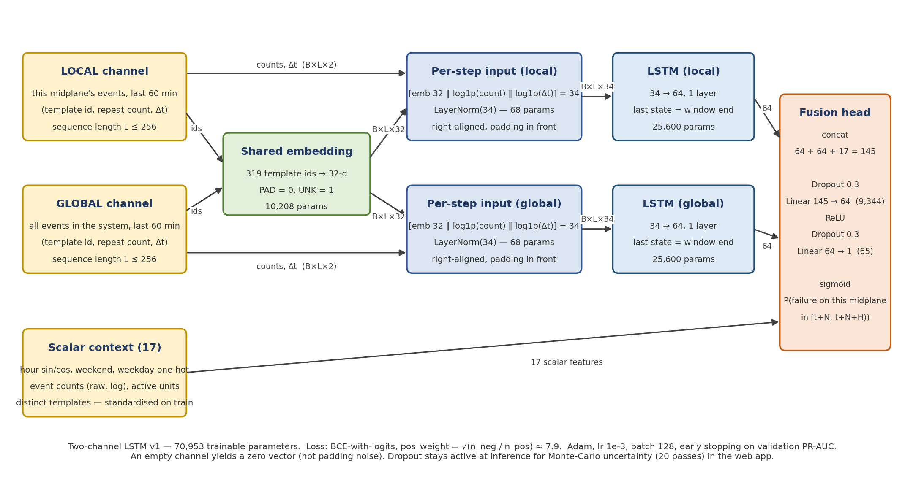

# LSTM v1 — architecture record (Question 2.a)

**Total trainable parameters: 70,953** (printed by `python -m src.models.train --config configs/lstm_v1.yaml`).

| Block | Input → output | Parameters | Why this choice |
|---|---|---|---|
| Shared template embedding | 319 ids → 32-d (PAD=0, UNK=1) | 319 × 32 = **10,208** | one meaning per message type in both channels; 32-d is ample for ~300 types; sharing halves the parameters and lets local and global evidence about the same message reinforce each other |
| Per-step input (×2 channels) | [emb 32 ‖ log1p(count) ‖ log1p(Δt)] = 34, LayerNorm(34) | 2 × (34 + 34) = **136** | repeat counts and inter-arrival gaps carry information beyond message identity (bursts vs. isolated lines); LayerNorm keeps the three scales comparable per step and works on variable-length, padded batches, where BatchNorm's batch statistics would be dominated by padding and by the few long storm windows |
| LSTM, local channel | 34 → 64, 1 layer, right-aligned, last hidden state | 4 × (34·64 + 64·64 + 64 + 64) = **25,600** | the unit's own evidence is an ordered sequence whose order and spacing may matter; the state at the window end is the natural summary for a prediction about the next minutes |
| LSTM, global channel | 34 → 64, 1 layer, right-aligned, last hidden state | **25,600** | the system's state is a different information source (Phase 2 diagnostics: units are mostly silent before their own failures, the system is not); separate weights because the two sequences describe different processes |
| Scalar context | 17 features (hour sin/cos, weekday one-hot, weekend, event counts, distinct templates), standardised with training statistics | 0 | time-of-day and raw volume are known confounders (Phase 3 confound baseline ROC ≈ 0.55); giving them explicitly lets the sequence encoders model *content* rather than schedule, and makes the "did it learn more than the confound?" comparison fair |
| Fusion head | 64 + 64 + 17 = 145 → Dropout(0.3) → Linear 64 → ReLU → Dropout(0.3) → Linear 1 | 145·64 + 64 + 64·1 + 1 = **9,409** | a small MLP to combine the three sources non-linearly; dropout regularises (~230 positive unit-episodes in training) and doubles as the Monte-Carlo-dropout uncertainty mechanism in the web app |
| Output and loss | sigmoid; BCE-with-logits, pos_weight = √(n_neg / n_pos) ≈ 7.9 | 0 | a binary decision with asymmetric costs (missed failure vs false alarm, Q1); the square root tempers over-firing at 1.5 % prevalence; the full ratio (≈ 65) and no weighting are tested in Phase 5 |

**Total:** 10,208 + 136 + 25,600 + 25,600 + 9,409 = 70,953.

## Depth and width
One recurrent layer with 64 units per channel. The training set holds ~230 positive unit-episodes (≈ 660 positive
windows at N = 5), too few to support a wider or deeper recurrent model without memorising; Xiao et al. (2026)
found a 64-unit LSTM already the least stable configuration under chronological BGL evaluation. Depth (2 layers)
and width (128, 256) are varied in the Phase 5 study with evidence rather than assumed.

## Assumptions about the data
1. A window is an ordered sequence of message types in which order and spacing may carry signal (LSTM rather than a bag of counts).
2. The same message type means the same thing wherever it appears (shared embedding).
3. The unit's own history and the system's state are distinct information sources (two encoders).
4. Repeat counts and inter-arrival gaps matter beyond identity (two extra input dimensions per step).
5. Schedule and volume effects are handled by the scalar context, not expected to be discovered by the encoders.
6. An empty channel is informative ("nothing logged") and is represented by a zero vector, not by padding noise.

## Consistency with the decision (Q1 → Q2.a)
The output is a score for "a target failure on this midplane starts in [t+N, t+N+H)". The administrator acts at a
threshold chosen on validation at a fixed false-alarm rate (1.4 or 14 alarms per midplane-day), because the cost of
a false alarm (a needless drain) is bounded while a missed failure loses the jobs on the midplane. The class-weighted
BCE loss pushes probability mass toward the rare positives without declaring the output a calibrated probability;
the web app labels it a model score and shows Monte-Carlo spread as an instability indicator.

## First runs (N = 5, seeds 11 / 22 / 33)
Learning curves: `results/figures/curves_lstm_v1_N5.png`. Training loss fell monotonically for every seed
(≈0.41 → 0.26–0.28). Validation loss reached its minimum at epoch 3–4 for all three seeds (0.322 / 0.322 / 0.332)
and rose steadily afterwards. Validation PR-AUC wandered in the 0.02–0.025 band with occasional single-epoch spikes;
best values 0.044 (epoch 10, seed 11), 0.023 (epoch 4, seed 22), 0.025 (epoch 8, seed 33); early stopping at
epochs 15 / 9 / 13.

**v1 result: validation PR-AUC 0.031 ± 0.012 (mean ± sd over three seeds), ROC-AUC ≈ 0.65 at the best epoch.**
Best XGBoost at N = 5 (Phase 3, single seed): PR-AUC 0.024, ROC 0.66. The two families are in the same place;
the seed spread of the ANN is larger than the gap between them, which is why every Phase 5 comparison uses the
three-seed mean.

Reading: the model over-fits from epoch 4 (loss) while its ranking of windows improves for a few more epochs,
the behaviour expected when a weak signal is learned alongside memorised noise. Early stopping on PR-AUC is
therefore partly selecting noise peaks; stronger regularisation and smaller learning rates are the Phase 5
experiments most likely to matter.
