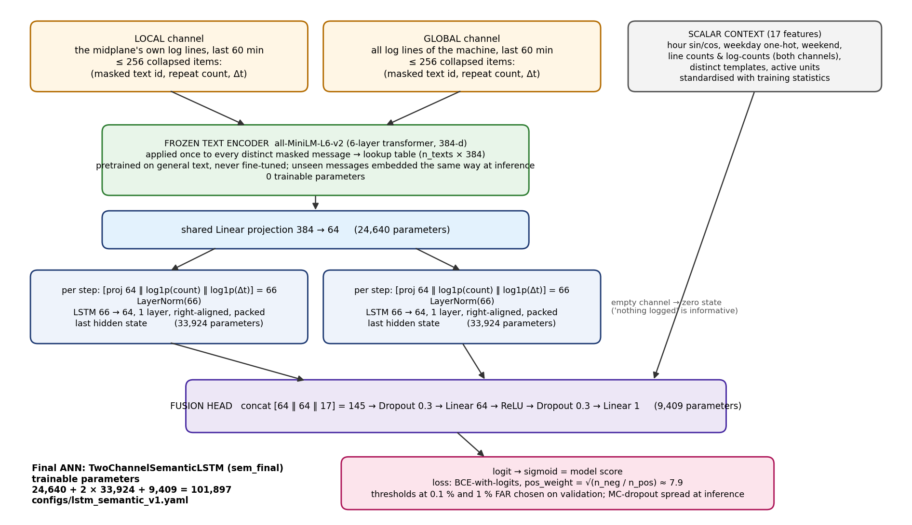

# Final ANN — TwoChannelSemanticLSTM (`sem_final`): architecture record

**Total trainable parameters: 101,897** (printed by `python -m src.models.train --config configs/lstm_semantic_v1.yaml`); the frozen text table adds 0 trainable parameters. The initial model (`lstm_v1`, 70,953 parameters, learned 32-d template embedding) is recorded in `docs/architecture_lstm_v1.md`; the only architectural difference is the input representation.

| Block | Input → output | Parameters | Why this choice |
|---|---|---|---|
| Frozen text encoder | every distinct masked message text → 384-d sentence embedding (all-MiniLM-L6-v2, 6-layer transformer, pretrained on general text) stored as a lookup table | 0 trainable | transfer learning where it is technically appropriate: 61–66 % of test-period lines belong to templates never seen in training (October 2005 software upgrade). A learned template embedding maps them all to UNK; the frozen encoder places "data cache search parity error detected" near "instruction cache parity error corrected". Nothing is fitted on validation or test; embedding a new message at inference is what deployment does (`add_texts` in the app). |
| Shared projection | 384 → 64, linear | 384·64 + 64 = **24,640** | adapts the general-purpose embedding to this task with few parameters; shared by both channels so a message means the same thing wherever it appears |
| Per-step input (×2 channels) | [proj 64 ‖ log1p(count) ‖ log1p(Δt)] = 66 → LayerNorm(66) | 2 × 132 = **264** | repeat counts and inter-arrival gaps carry information beyond message identity (bursts vs isolated lines); LayerNorm keeps the three scales comparable and made training stable up to lr 1e-2 (Phase 5) |
| LSTM, local channel | 66 → 64, 1 layer, right-aligned padding + packing, last hidden state | 4 × (66·64 + 64·64 + 2·64) = **33,792** | the midplane's own evidence is an ordered sequence; the last state summarises it. One layer of 64 units: depth 2 and width 128 were tested and bought nothing (Phase 5, F5.3) |
| LSTM, global channel | same | **33,792** | the machine-wide state is a separate information source; precursor diagnostics showed the failing unit is silent before most failures while the system is active (Phase 2) |
| Scalar context | 17 features (hour sin/cos, weekday one-hot, weekend; line counts and log counts for both channels; distinct templates; active units), standardised with training statistics | 0 | schedule and volume are known confounders (confound baseline ROC ≤ 0.61); giving them to the head explicitly lets the encoders concentrate on content. **No failure-history features** — a decision taken on validation evidence (history-only XGBoost at chance) that the test period later contradicted (Phase 7, F7.2) |
| Fusion head | 64 + 64 + 17 = 145 → Dropout 0.3 → Linear 64 → ReLU → Dropout 0.3 → Linear 1 | 145·64 + 64 + 64 + 1 = **9,409** | a small MLP combines the three sources non-linearly; dropout is the regulariser (0.1 and 0.5 tested, F5.5); dropout kept active at inference gives the Monte-Carlo spread shown in the app |
| Output and loss | sigmoid score; BCE-with-logits, pos_weight = √(n_neg/n_pos) ≈ 7.9; thresholds at 0.1 % and 1 % FAR chosen on validation | 0 | a binary decision with asymmetric costs (Q1): a false alarm costs a needless drain/checkpoint, a miss loses the jobs on the midplane. The √ratio tempers over-firing at ~1.5 % prevalence; full ratio and no weighting were tested (F5.5). The score is a ranking signal, not a calibrated probability |

**Total:** 24,640 + 264 + 33,792 + 33,792 + 9,409 = 101,897.

## Assumptions the architecture makes, and why they suit the problem
1. *The meaning of a log line is in its words.* Pretrained sentence embeddings carry that meaning for lines never seen before; the template model could not (test UNK 66 %).
2. *A window is an ordered sequence in which order and spacing may matter.* An LSTM reads it in order; Phase 5 showed order-insensitive pooling performs equally, so this assumption is held weakly and the model does not depend on it.
3. *The unit's own lines and the machine-wide lines are different information sources.* Two encoders; the global channel carries most of the signal (82–88 % of positives have an empty local channel).
4. *"Nothing logged" is informative.* An empty channel yields a zero state rather than padding noise; the empty-window baseline score is 0.02–0.11.
5. *Schedule and volume should be given, not discovered.* Explicit scalar context; confound baseline confirms they are weak predictors.

## Design decisions with their evidence (Phase 5, validation only, seed 11; v1 seed spread ± 0.012)
Depth: 1 vs 2 layers (0.0437 vs 0.0432). Width: 32 / 64 / 128 (0.0301 / 0.0437 / 0.0381). Normalisation: with vs without LayerNorm (0.0437 vs 0.0288, within noise; kept for stability). Regularisation: dropout 0.1 / 0.3 / 0.5 (0.0255 / 0.0437 / 0.0379). Pooling: last state vs mean+max (0.0437 vs 0.0411). Input representation: learned template embedding vs frozen text embedding (0.0437 single seed, **0.0305 ± 0.0115** over seeds vs **0.0322 ± 0.0004**). Loss weighting: none / √ratio / ratio (0.0277 / 0.0437 / 0.0326). The final configuration is the smallest one on the plateau whose input representation generalises to unseen messages.

## Consistency with the decision
The output is a score for "a target kernel failure on this midplane starts in [t+N, t+N+10 min)". The administrator acts at a threshold fixed on validation at 1.4 or 14 false alarms per midplane-day; the loss weighting and the two operating points follow from the asymmetric costs identified in Q1. The web application labels the output a model score, shows the Monte-Carlo spread as an instability indicator, and states the final test result (PR-AUC 0.024 at prevalence 0.018, ROC 0.60) in its limitations panel.

## Training behaviour (learning curves)
`results/figures/curves_sem_final_N5.png` (three seeds; produced by `python -m src.models.plot_curves --runs sem_final_N5_s11 sem_final_N5_s22 sem_final_N5_s33 --out sem_final_N5`). Best epochs 15 / 15 / 18 of 20 / 20 / 23 (patience 5), training time 40–45 min per seed on CPU; validation PR-AUC 0.0327 / 0.0322 / 0.0318. Compared with v1 (best epochs 10 / 4 / 8, PR-AUC 0.044 / 0.023 / 0.025) the semantic model trains longer and lands in the same place every time: the frozen input removes the initialisation variance that made v1's curves seed-dependent. Validation loss still reaches its minimum early (epochs 3–5) while PR-AUC keeps improving, so the model is limited by signal, not by capacity: training loss keeps falling, validation ranking plateaus, and no configuration in the study broke through the plateau.
