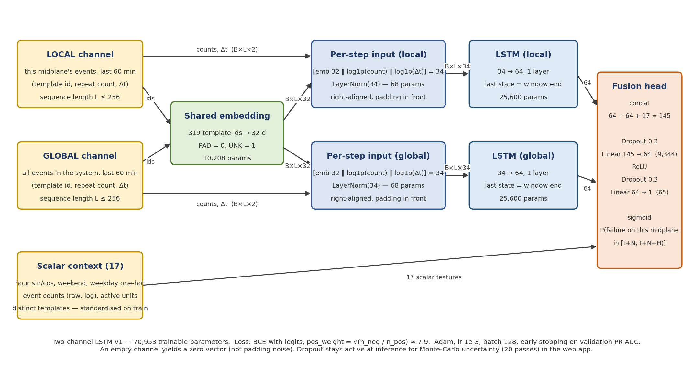

# Report draft — Questions 1 and 2

> Working draft written from the project artefacts (results/*.md, docs/*.md, experiments/log.csv). Every number has a
> file reference in brackets so it can be checked. Edit freely: this must read in your voice before submission.
> Figures referenced here exist in `results/figures/` and `report/figures/`.

---

## Question 1 — Dataset and exploratory data analysis

### 1.1 Problem, user and decision

A BlueGene/L supercomputer writes millions of RAS (reliability, availability, serviceability) log lines. Today an
administrator learns that part of the machine has failed only after the failure, when the jobs running there are
lost. This project asks whether the log lines written in the hour *before* a failure contain enough warning to
predict it, with an enforced lead time, so that the administrator can act first.

The user of this system is the **system administrator operating the cluster**. When the model predicts that a
**midplane** (the 512-node unit in which BlueGene/L allocates jobs) will suffer a kernel-level failure within the
next N minutes, the administrator **withholds that midplane from the next job allocation, or checkpoints and drains
the jobs running on it**, instead of discovering the failure afterwards. The prediction unit was initially the
single node; Section 1.6 explains, with measurements, why it became the midplane.

### 1.2 Dataset

| Item | Value |
|---|---|
| Source | BlueGene/L system logs, Lawrence Livermore National Laboratory, distributed by the Loghub collection (Zhu et al., ISSRE 2023), Zenodo DOI 10.5281/zenodo.8196385 [`configs/project.yaml`] |
| Licence | CC BY 4.0 with a citation condition (Loghub) [`README.md`] |
| Size | 4,747,963 lines, 743 MB raw; 0 malformed lines dropped by the parser [`results/bgl_parsed_parse_stats.json`] |
| Span | 3 June 2005 → 4 January 2006, 214 days [`results/eda_summary.md`] |
| Structure | per line: alert tag (`-` or a category), epoch timestamp, node id (rack–midplane–node card–chip), component, level, free-text message; 69,252 distinct node ids, 67 racks, 139 midplanes, 2,703 node cards |
| Alert lines | 348,460 (7.34 %), 41 alert categories; all alert categories carry level FATAL or FAILURE [`results/eda_alert_component_level.csv`] |
| Personal data | none (machine identifiers and system messages only); no anonymisation required |
| Reproduction | `src/data/download.py` verifies the Zenodo MD5 and extracts; a 20,000-line representative sample ships with the code and runs the whole pipeline [`data/sample/bgl_sample.log`] |

### 1.3 Exploratory analysis

*Volume and burstiness.* Daily volume varies about 100-fold (median 5,075 lines/day, maximum 392,069; busy
June–September, quiet October–January) [`results/figures/eda_01_volume_per_day.png`]. 48.1 % of consecutive alerts
on the same node are ≤ 1 s apart and 30.4 % of all lines repeat the previous line on the same node
[`results/figures/eda_04_alert_gaps.png`]. The top 1 % of nodes produce 17.3 % of all lines; the median node writes
only tens of lines in seven months [`results/figures/eda_02_lines_per_node.png`].

*Alert categories.* Five categories (KERNDTLB, KERNSTOR, APPSEV, KERNMNTF, KERNTERM) account for 93 % of alert lines
[`results/figures/eda_03_alert_categories.png`]. Categories split into kernel/hardware (`KERN*`), application
(`APP*`, written by the I/O daemon when a user program fails), and infrastructure (`LINK*`, `MAS*`, `MON*`).

*Time of day.* Alert lines peak at 09:00 and 17:00–23:00 local time; overall volume peaks mid-morning
[`results/figures/eda_05_hour_of_day.png`]. Time of day is therefore a confounder that any model must be shown to
beat.

*Replication across nodes.* Several categories are logged by whole partitions at once: APPSEV by exactly 1,024 nodes,
KERNMNTF by 1,024, APPREAD by 512 [`results/category_evidence.md`]. Counting system-wide incidents (same category
within 5 min anywhere) instead of node episodes collapses KERNSTOR from 63,491 episodes to 8 incidents, with a median
of 1,874 nodes logging it in the same minute.

### 1.4 Failure definition

Because the alert tags are machine-assigned and heterogeneous, the target was defined explicitly and frozen before any
modelling [`docs/failure_definition.md`, `configs/failure_definition.yaml`]:

1. a *target failure event* is a `KERN*` alert line, excluding `KERNMNTF`/`KERNMNT` (Lustre mount failures: the fault
   is on the I/O server, so the node-drain decision does not apply);
2. events belonging to a *mass-synchronous incident* (more than 32 nodes — one node card — logging the same category
   within 60 s) are excluded: these are job- or partition-level events, not node faults (110 incidents, 98,364 lines);
3. target events on one node within 300 s form an *episode*; episodes anywhere within 300 s form an *incident*, the
   unit for support counting and per-incident metrics; a category is evaluable at ≥ 30 incidents.

Result: 153,729 target lines → **937 node episodes → 502 incidents** on 705 nodes
[`results/failure_set_summary.md`]. Evaluable categories: KERNMC (machine check, 290 incidents), KERNRTSP (panic, 50),
KERNSOCK (control-network socket lost, 38), KERNDTLB (TLB error storm, 30). `APP*` and the other non-target alerts
(96,367 lines) form a hard-negative pool: alert-rich windows that are not followed by a node failure. The definition
uses the whole log; it is a label definition, not a model decision, and is declared as such.

### 1.5 Costs of errors and the primary metric

A **false alarm** costs a needless drain or a midplane withheld from one allocation cycle: bounded, but if it
happens many times a day the administrator will ignore the system. A **missed failure** loses the jobs running on
the midplane and triggers a manual recovery: the costlier error, but one the administrator already lives with.
Positives are rare (≈ 1.5 % of evaluation windows), so accuracy and ROC-AUC flatter any model.

Primary metric: **average precision (PR-AUC)** on the frozen validation split, per lead time N — threshold-free and
prevalence-aware. Operating points: recall, precision and per-incident recall at **false-alarm rates of 0.1 % and
1 % of negative windows**; because negatives are uniform (midplane, minute) draws, these correspond to **1.4 and 14
false alarms per midplane per day**. Thresholds are chosen on validation and frozen [`src/utils/metrics.py`].
Reference benchmark: a constant score (PR-AUC = prevalence, recall 0 at any false-alarm rate).

### 1.6 Three findings that constrain the modelling (and a fourth that changed the design)

**Finding 1 — Replication, not abundance.** 348,460 alert lines look like a rich failure signal, but bursts and
partition-wide replication mean there are only 502 independent node-failure incidents in seven months. Consequence:
events are collapsed into episodes and incidents; exact-duplicate windows are removed within and across splits; every
result is also reported per incident. Without this, one failure is counted thousands of times, and copies of it land
on both sides of the train/test boundary — which is how the published near-perfect scores on this dataset arise
(Le & Zhang, 2022; Xiao et al., 2026).

**Finding 2 — Not every alert is a node failure.** Application errors, filesystem faults and partition-level events
dominate the alert count but do not match the administrator's decision. Consequence: a behaviour-based target
definition, a hard-negative pool, per-category evaluation, and an "insufficient support" rule.

**Finding 3 — Strong time dependence.** 100-fold volume variation, hour-of-day peaks, incidents per month falling
from 109 (August) to 2 (January), and a **control-software upgrade in October 2005** (`idoproxydb … $Name:
V1R1M2_254/255`) after which the kernel emits new RAS message types: **61.4 % of test-period lines belong to templates
never seen in training** (3.4 % in validation) [`results/template_report.md`, `results/unk_diagnostics.md`].
Consequence: a strictly chronological split; the log parser fitted on the training period only, with the unknown-
template rate as a protocol field; a content-free time/volume baseline; and message *text* kept alongside template
ids so that a pretrained text encoder can represent unseen messages.

**Finding 4 — Failures have no local log precursor; the node is the wrong unit.** Measured directly
[`results/precursor_diagnostics.md`]: in the hour before a target failure the failing node has logged nothing in
90–97 % of cases, its node card in 85 %, its midplane in 66 %, its rack in 60 %; only the whole system is reliably
active. A first dataset built at node level produced positive windows that were empty 99.9 % of the time against
non-empty negatives — a sampling artefact that would have been "learned" with near-perfect scores. Consequence: the
unit of prediction is the midplane; each window has two channels (the midplane's own lines and the system's lines,
60 min each); negatives are drawn uniformly over (midplane, minute) so that emptiness is not a label proxy.

### 1.7 Split, windows and leakage checks

*Split.* One chronological split, used by every model and by the LLM. Cut dates are the next UTC midnight after the
60 % and 80 % quantiles of target incidents: train 3 Jun–30 Sep (302 incidents), validation 1 Oct–5 Nov (99),
test 6 Nov–4 Jan (101) [`data/splits/split_v1.json`, `results/split_report.md`]. Only incident counts position the
cuts; no window contents or labels are used.

*Templates.* Drain3 fitted on training-period messages only, after masking numbers, hex, node ids, hosts, paths and
file names with a single wildcard; 317 templates; later messages matched in inference mode, unmatched → UNK
(index 1). UNK rate: train 0 %, validation 3.4 %, test 61.4 % of lines. A *transductive control* (Drain on all
data, the protocol of most prior work) yields 530 templates and 0 % UNK everywhere; it is used only as a labelled
control [`results/template_report.md`, `results/template_report_tc.md`].

*Windows.* For midplane u and window end t: local channel = u's events in [t−60 min, t]; global channel = all events
in the same interval; each as (template, text id, repeat count, Δt), consecutive repeats collapsed, last 256 items
kept. Label for lead time N ∈ {1, 5, 15, 30} min: 1 if a target episode of u starts in [t+N, t+N+10 min), 0
otherwise, and *excluded* if a target episode of u occurred in the last 60 min, within 20 min after an episode, inside
the gap (t, t+N), if a mass-incident line of u falls in the window or horizon, or if the span crosses a split cut.
Window ends: five offsets before each unit-episode (positives), 70,000 uniform (midplane, minute) draws (negatives),
7,200 ends 30 s after a non-target alert (hard negatives) [`configs/windows.yaml`, `results/windows_summary.md`].

*Class distribution (N = 5).* Train 664 positives / 41,713 negatives (229 unit-episodes); validation 193 / 15,599
(67 episodes, 64 incidents); test 286 / 17,028 (88 episodes, 62 incidents) [`results/class_distribution.csv`].

*Leakage checks* [`results/leakage_report.txt`, all PASS]: chronological order of all window ends; no specific window
content (≥ 3 items) shared across splits; no target line of the labelled midplane within the 60-min guard before a
kept window; nothing after the window end in the global channel; mass-incident windows excluded; the model-input
columns contain no identifiers or labels; UNK rate per split and channel reported.

*Data quality.* 316 lines with shifted fields (level values such as "Kill"), all non-alert; timestamps taken from the
epoch field (UTC) while the human-readable field is US/Pacific; 30 % consecutive duplicates collapsed to counts.

---

## Question 2 — Solution design

### 2.a The artificial neural network

**Architecture (70,953 trainable parameters)** [`docs/architecture_lstm_v1.md`, `src/models/lstm.py`]:

| Block | Shape | Params | Justification |
|---|---|---|---|
| Shared template embedding | 319 → 32 | 10,208 | one meaning per message type in both channels |
| Per-step input, each channel | [emb 32 ‖ log1p(count) ‖ log1p(Δt)] = 34, LayerNorm | 2 × 68 | repeat counts and gaps carry information beyond identity; LayerNorm works on variable-length padded batches where BatchNorm's batch statistics would be dominated by padding and storm windows |
| LSTM, local channel | 34 → 64, 1 layer, right-aligned, last state | 25,600 | ordered evidence from the unit itself; the state at the window end is the summary for a prediction about the next minutes |
| LSTM, global channel | 34 → 64, 1 layer | 25,600 | the system state is a different information source (Finding 4) |
| Scalar context | 17 (hour sin/cos, weekday, counts), standardised on train | 0 | known confounders given explicitly so the encoders model content, not schedule |
| Fusion head | 145 → Dropout 0.3 → 64 → ReLU → Dropout → 1 | 9,409 | small non-linear combination; dropout regularises (~230 positive episodes) and provides Monte-Carlo uncertainty in the application |
| Output / loss | sigmoid; BCE-with-logits, pos_weight = √(n_neg/n_pos) ≈ 7.9 | — | binary decision with asymmetric costs; √ tempers over-firing at 1.5 % prevalence (full ratio and no weighting tested in Q3.b) |

Depth 1 and width 64: the training set holds ~230 positive unit-episodes (664 positive windows at N = 5), too few
for a wider or deeper recurrent model without memorising; Xiao et al. (2026) found a 64-unit LSTM already the least
stable configuration under chronological BGL evaluation. Depth and width are varied with evidence in Q3.b.

**Assumptions the architecture makes about the data.** (1) A window is an ordered sequence whose order and spacing
may carry signal. (2) A message type means the same thing wherever it appears. (3) The unit's own history and the
system's state are distinct sources. (4) Repeat counts and inter-arrival gaps matter beyond identity. (5) Schedule and
volume effects are handled by the scalar context. (6) An empty channel is informative and is represented by a zero
vector, not by padding noise. Assumptions 3 and 6 follow directly from Finding 4.

**Consistency of loss and output with the decision.** The output is a score for "a target failure on this midplane
starts in [t+N, t+N+H)". The administrator acts at a threshold chosen on validation at a fixed false-alarm rate,
because the cost of a false alarm is bounded while a missed failure loses the jobs on the midplane (Q1.5). The
class-weighted BCE loss moves probability mass toward rare positives without claiming calibrated probabilities; the
web application labels the output a model score and shows the Monte-Carlo spread as an instability indicator.

### 2.b Alternative approaches

**Why a neural network at all.** The input is unstructured, variable-length, sequential text (log messages with
timestamps), which the brief identifies as the natural case for neural architectures; the two-channel structure and
the need to represent unseen message text (Finding 3) are awkward for fixed-length tabular methods. But the volume of
positive signal is small, so the classical baseline is given the same tuning budget and may well win.

**Alternatives considered.**

| Alternative | When it would be the right choice | Why less suitable here |
|---|---|---|
| Gradient boosting on template-count features (the chosen classical baseline) | signal is "which messages appear, how often" rather than their order; small data | kept as the baseline with equal budget; cannot represent unseen message text; cannot use order or spacing |
| Rule-based alerting (thresholds on corrected-error counts) | precursors are few and known | precursors unknown a priori; the point of the study is to find out whether any exist |
| Autoencoder / next-event anomaly detection (DeepLog-style) | abundant normal data, anomaly = "unusual sequence", no need for a lead time | detects the failure once its lines appear; the task here is prediction with an enforced gap; produces no FP/FN cost analysis against a defined target |
| Transformer encoder over the sequence | long sequences with long-range dependencies and ample labelled data | ~230 positive episodes; Hadadi et al. (2024) found transformers worst below ~1,000 sequences; CPU budget |
| Fine-tuning a large pretrained language model on raw log text | many labelled examples, GPU, text-rich messages | CPU only, few positives; instead a frozen pretrained sentence encoder is used (Q3.b semantic variant), which is the appropriate form of transfer learning at this scale |
| 1-D CNN over the sequence | evidence is local n-gram patterns anywhere in the window | tested as the architecture alternative in Q3.b (Hadadi et al. found it best for prediction) |
| System-level prediction (one unit) | failure precursors are system-wide | tested in Phase 3: at chance (ROC 0.43–0.55) [`results/baselines_validation_system.csv`]; loses the per-unit decision |

**Expectation stated before evaluation** [`report/expectation.md`, dated 24 Oct 2026]. All models will achieve
modest PR-AUC, because the precursor diagnostics show little local signal and only mild system-wide elevation.
XGBoost on count features will be at least competitive with the sequence model, probably better at N = 1 min; the
sequence model may gain as N grows but no large gap is expected (Xiao et al., 2026: gradient boosting strongest and a
small LSTM weakest under chronological BGL). The content-free confound baseline will sit between trivial and the
content models. Everything will degrade on the test period because of the October upgrade; the semantic variant
should degrade least. The earliness curve will be flat or falling with N.

*Status at the time of writing (validation, N = 5):* trivial 0.011; confound 0.017; best XGBoost 0.024 (ROC 0.66);
LSTM v1 0.031 ± 0.012 over three seeds (ROC ≈ 0.65). The families are indistinguishable within seed spread, which is
itself one of the expected outcomes. Failure-history features, added as an ablation, transferred nothing across
periods (ROC 0.43–0.52); system-level prediction was at chance; the local window length (1 h / 6 h / 24 h) made no
difference [`results/baselines_validation*.csv`]. These results are reported in full in Question 3.

---

### References used in Q1–Q2
- Zhu, J. et al. (2023). Loghub: A Large Collection of System Log Datasets for AI-driven Log Analytics. ISSRE.
- Oliner, A. & Stearley, J. (2007). What Supercomputers Say: A Study of Five System Logs. DSN.
- Le, V.-H. & Zhang, H. (2022). Log-based Anomaly Detection with Deep Learning: How Far Are We? ICSE.
- Xiao, H. et al. (2026). Protocol-Sensitive Evaluation of Log Anomaly Detection: Component Costs and Target-Access Sensitivity on HDFS and BGL. DASC.
- Hadadi, F. et al. (2024). Systematic Evaluation of Deep Learning Models for Log-based Failure Prediction. Empirical Software Engineering 29:105.
- Das, A. et al. (2018). Desh: Deep Learning for System Health Prediction of Lead Times to Failure in HPC. HPDC.
- He, P. et al. (2017). Drain: An Online Log Parsing Approach with Fixed Depth Tree. ICWS.
