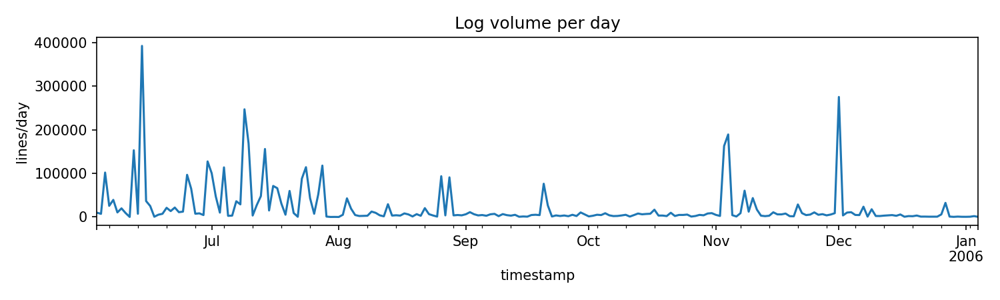
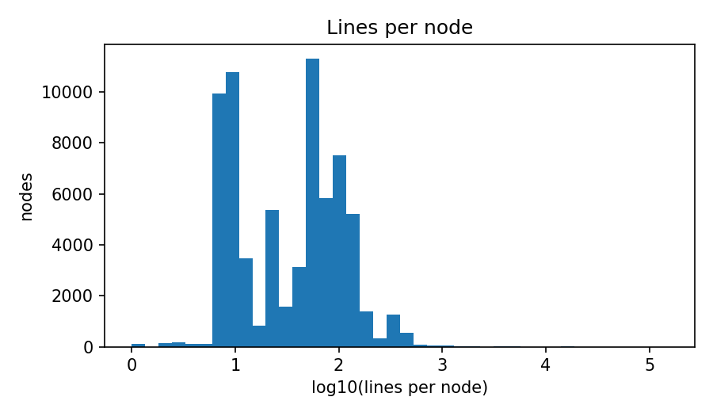
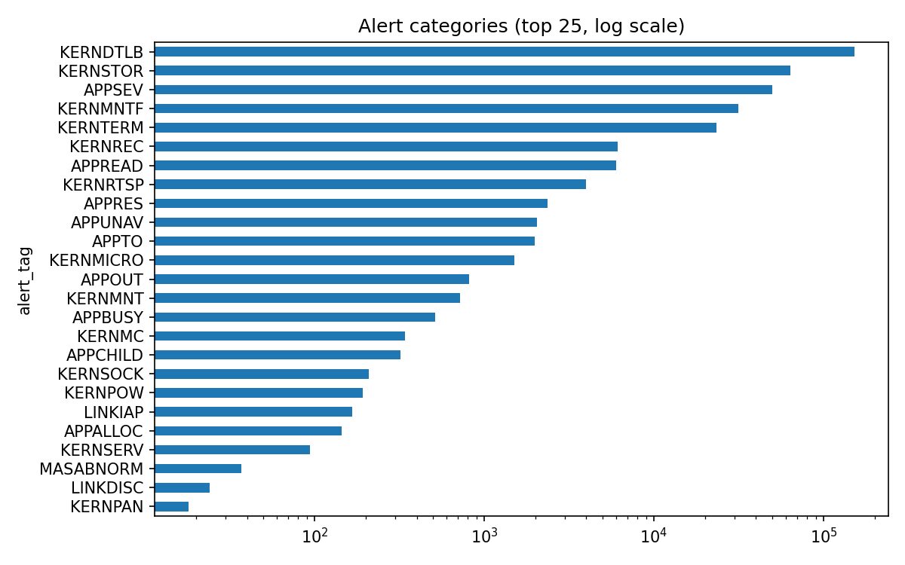
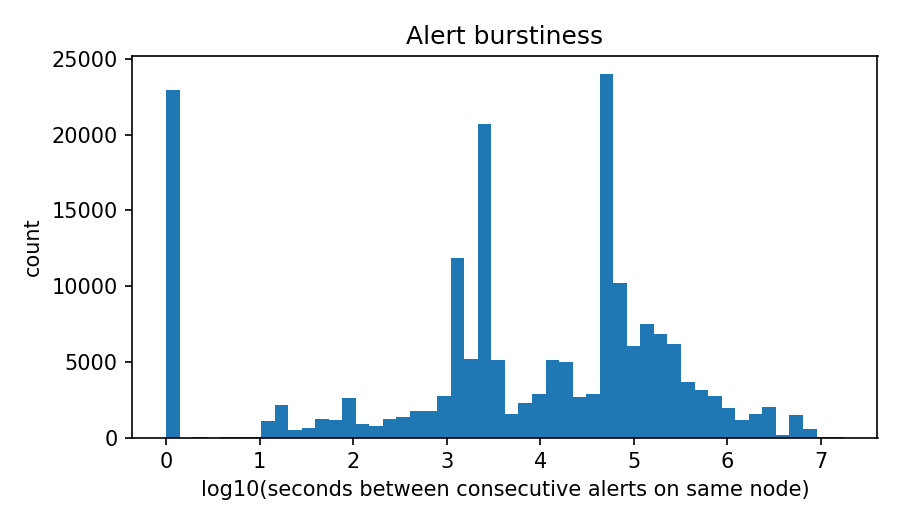
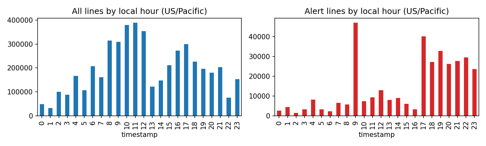

# EDA summary (auto-generated by src/data/eda.py)

Source parquet: `E:\Projects\bgl-failure-prediction\data\interim\bgl_parsed.parquet`

- Rows: **4,747,963**
- Time span: **2005-06-03 22:42:50+00:00 → 2006-01-04 16:00:05+00:00** (214 days)
- Distinct nodes: **69,252**; racks: 67; node cards: 2,703
- Alert lines: **348,460** (7.34%)
- Distinct alert categories: **41**

## Volume per day

Median 5,075 lines/day; max 392,069; 1 days with no lines.

## Lines per node

Top 1% of nodes produce 17.3% of all lines.

## Alert categories

| alert_tag   |   lines |
|:------------|--------:|
| KERNDTLB    |  152734 |
| KERNSTOR    |   63491 |
| APPSEV      |   49651 |
| KERNMNTF    |   31531 |
| KERNTERM    |   23338 |
| KERNREC     |    6145 |
| APPREAD     |    5983 |
| KERNRTSP    |    3983 |
| APPRES      |    2370 |
| APPUNAV     |    2048 |
| APPTO       |    1991 |
| KERNMICRO   |    1503 |
| APPOUT      |     816 |
| KERNMNT     |     720 |
| APPBUSY     |     512 |
| KERNMC      |     342 |
| APPCHILD    |     320 |
| KERNSOCK    |     209 |
| KERNPOW     |     192 |
| LINKIAP     |     166 |
| APPALLOC    |     144 |
| KERNSERV    |      94 |
| MASABNORM   |      37 |
| LINKDISC    |      24 |
| KERNPAN     |      18 |
| KERNCON     |      16 |
| KERNNOETH   |      14 |
| LINKPAP     |      14 |
| MONPOW      |      12 |
| MASNORM     |      10 |
| APPTORUS    |      10 |
| KERNPROG    |       5 |
| KERNRTSA    |       3 |
| MMCS        |       3 |
| KERNFLOAT   |       3 |
| MONNULL     |       2 |
| LINKBLL     |       2 |
| KERNEXT     |       1 |
| KERNBIT     |       1 |
| MONILL      |       1 |
| KERNTLBE    |       1 |

## Alert category × component × level

Saved to `results/eda_alert_component_level.csv`. Top 30 rows:

| alert_tag   | component   | level   |   lines |
|:------------|:------------|:--------|--------:|
| KERNDTLB    | KERNEL      | FATAL   |  152734 |
| KERNSTOR    | KERNEL      | FATAL   |   63491 |
| APPSEV      | APP         | FATAL   |   49651 |
| KERNMNTF    | KERNEL      | FATAL   |   31531 |
| KERNTERM    | KERNEL      | FATAL   |   23338 |
| KERNREC     | KERNEL      | FATAL   |    6145 |
| APPREAD     | APP         | FATAL   |    5983 |
| KERNRTSP    | KERNEL      | FATAL   |    3983 |
| APPRES      | APP         | FATAL   |    2370 |
| APPUNAV     | APP         | FATAL   |    2048 |
| APPTO       | APP         | FATAL   |    1991 |
| KERNMICRO   | KERNEL      | FATAL   |    1503 |
| APPOUT      | APP         | FATAL   |     816 |
| KERNMNT     | KERNEL      | FATAL   |     720 |
| APPBUSY     | APP         | FATAL   |     512 |
| KERNMC      | KERNEL      | FATAL   |     342 |
| APPCHILD    | APP         | FATAL   |     320 |
| KERNSOCK    | KERNEL      | FATAL   |     209 |
| KERNPOW     | KERNEL      | FATAL   |     192 |
| LINKIAP     | LINKCARD    | FATAL   |     166 |
| APPALLOC    | APP         | FATAL   |     144 |
| KERNSERV    | KERNEL      | FATAL   |      94 |
| MASABNORM   | BGLMASTER   | FAILURE |      37 |
| LINKDISC    | LINKCARD    | FATAL   |      24 |
| KERNPAN     | KERNEL      | FATAL   |      18 |
| KERNCON     | KERNEL      | FATAL   |      16 |
| KERNNOETH   | KERNEL      | FATAL   |      14 |
| LINKPAP     | LINKCARD    | FATAL   |      14 |
| MONPOW      | MONITOR     | FAILURE |      12 |
| APPTORUS    | APP         | FATAL   |      10 |

Level counts over all lines:

| level        |            lines |
|:-------------|-----------------:|
| INFO         |      3.73581e+06 |
| FATAL        | 855195           |
| ERROR        | 112355           |
| WARNING      |  23357           |
| SEVERE       |  19213           |
| FAILURE      |   1714           |
| Kill         |    306           |
| microseconds |      4           |
| single       |      4           |
| 0x00544eb8,  |      2           |

## Burstiness of alerts

48.1% of consecutive same-node alerts are ≤1 s apart; 50.1% are ≤60 s apart; median gap 56 s.

## Repeated lines
30.4% of lines repeat the previous message on the same node.

## Top 30 raw messages
| message                                                                                                                                                                                                                                                                                                                                                                                           |   lines |
|:--------------------------------------------------------------------------------------------------------------------------------------------------------------------------------------------------------------------------------------------------------------------------------------------------------------------------------------------------------------------------------------------------|--------:|
| data TLB error interrupt                                                                                                                                                                                                                                                                                                                                                                          |  152734 |
| 0 microseconds spent in the rbs signal handler during 0 calls. 0 microseconds was the maximum time for a single instance of a correctable ddr.                                                                                                                                                                                                                                                    |  135005 |
| instruction cache parity error corrected                                                                                                                                                                                                                                                                                                                                                          |  105924 |
| idoproxydb hit ASSERT condition: ASSERT expression=0 Source file=idotransportmgr.cpp Source line=1043 Function=int IdoTransportMgr::SendPacket(IdoUdpMgr*, BglCtlPavTrace*)                                                                                                                                                                                                                       |   84168 |
| 1146800 double-hummer alignment exceptions                                                                                                                                                                                                                                                                                                                                                        |   74091 |
| 8 floating point alignment exceptions                                                                                                                                                                                                                                                                                                                                                             |   65558 |
| data storage interrupt                                                                                                                                                                                                                                                                                                                                                                            |   63493 |
| 5 floating point alignment exceptions                                                                                                                                                                                                                                                                                                                                                             |   53099 |
| instruction address: 0x00004ed8                                                                                                                                                                                                                                                                                                                                                                   |   47104 |
|                                                                                                                                                                                                                                                                                                                                                                                                   |   34470 |
| 15 floating point alignment exceptions                                                                                                                                                                                                                                                                                                                                                            |   32769 |
| 344040 double-hummer alignment exceptions                                                                                                                                                                                                                                                                                                                                                         |   23433 |
| 2354412 floating point alignment exceptions                                                                                                                                                                                                                                                                                                                                                       |   22800 |
| ciod: Error loading /bgl/apps/scaletest/performance/MINIBEN/mb_243_0810/allreduce.rts: invalid or missing program image, Exec format error                                                                                                                                                                                                                                                        |   20480 |
| machine check: i-fetch......................0                                                                                                                                                                                                                                                                                                                                                     |   18017 |
| ciod: Received signal 15, code=0, errno=0, address=0x000001f2                                                                                                                                                                                                                                                                                                                                     |   17564 |
| Node card is not fully functional                                                                                                                                                                                                                                                                                                                                                                 |   17364 |
| Can not get assembly information for node card                                                                                                                                                                                                                                                                                                                                                    |   17305 |
| Node card status: no ALERTs are active. Clock Mode is Low. Clock Select is Midplane. Phy JTAG Reset is asserted. ASIC JTAG Reset is asserted. Temperature Mask is not active. No temperature error. Temperature Limit Error Latch is clear. PGOOD IS NOT ASSERTED. PGOOD ERROR LATCH IS ACTIVE. MPGOOD IS NOT OK. MPGOOD ERROR LATCH IS ACTIVE. The 2.5 volt rail is OK. The 1.5 volt rail is OK. |   16896 |
| total of 1 ddr error(s) detected and corrected                                                                                                                                                                                                                                                                                                                                                    |   16535 |
| 1005 floating point alignment exceptions                                                                                                                                                                                                                                                                                                                                                          |   16384 |
| 685 floating point alignment exceptions                                                                                                                                                                                                                                                                                                                                                           |   16384 |
| 62500 floating point alignment exceptions                                                                                                                                                                                                                                                                                                                                                         |   15213 |
| MACHINE CHECK DCR read timeout (mc=e08x iar 0x00000000 lr 0xc00045a4)                                                                                                                                                                                                                                                                                                                             |   14481 |
| exception syndrome register: 0x00800000                                                                                                                                                                                                                                                                                                                                                           |   14341 |
| data address: 0x00000002                                                                                                                                                                                                                                                                                                                                                                          |   14336 |
| data cache search parity error detected. attempting to correct                                                                                                                                                                                                                                                                                                                                    |   13941 |
| ciod: generated 128 core files for program /home/germann2/BGL-demo/SPaSM_mpi                                                                                                                                                                                                                                                                                                                      |   12468 |
| 3091200 double-hummer alignment exceptions                                                                                                                                                                                                                                                                                                                                                        |   12078 |
| iar 00106210 dear 0244c20c                                                                                                                                                                                                                                                                                                                                                                        |   11462 |

## Hour-of-day profile

## Three findings that constrain modelling

This file is regenerated on every run. The findings are written and maintained in `docs/eda_findings.md`.
