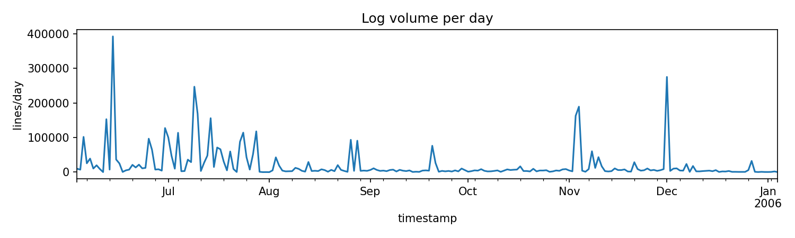
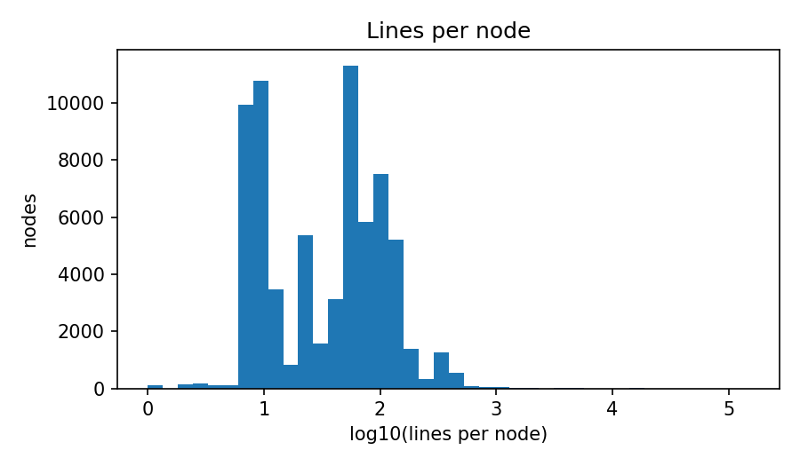
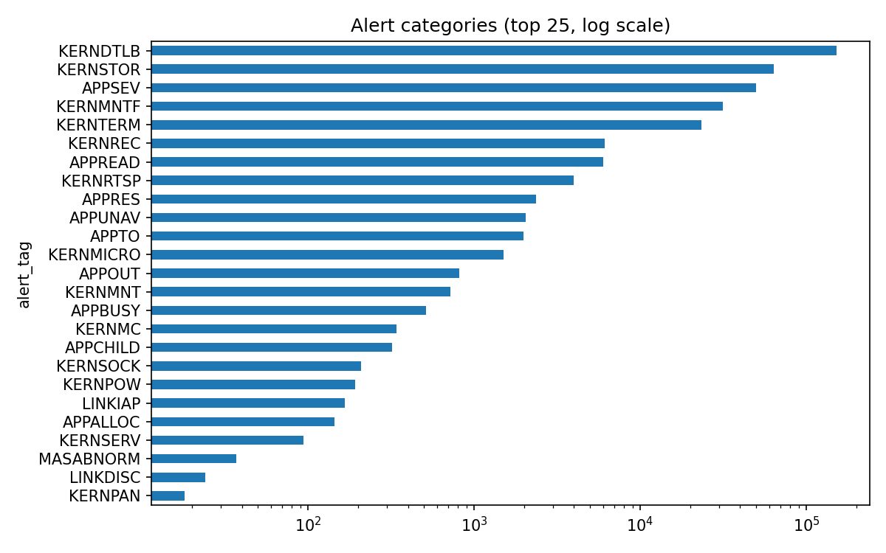
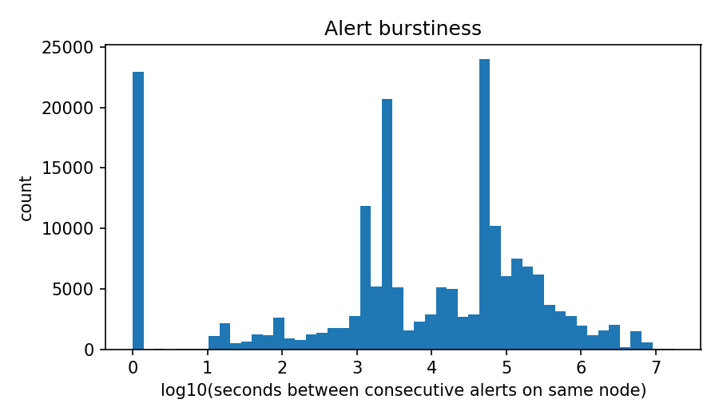
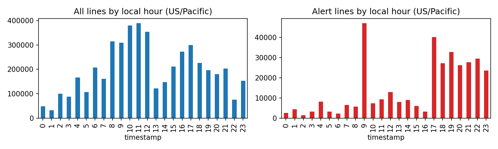

# EDA summary (auto-generated by src/data/eda.py)

Source parquet: `E:\Projects\bgl-failure-prediction\data\interim\bgl_parsed_sample.parquet`

- Rows: **20,000**
- Time span: **2005-07-01 23:56:35+00:00 → 2005-11-21 04:08:09+00:00** (142 days)
- Distinct nodes: **10,604**; racks: 65; node cards: 961
- Alert lines: **1,342** (6.71%)
- Distinct alert categories: **6**

## Volume per day

Median 0 lines/day; max 5,000; 135 days with no lines.

## Lines per node

Top 1% of nodes produce 24.2% of all lines.

## Alert categories

| alert_tag   |   lines |
|:------------|--------:|
| KERNTERM    |     783 |
| APPSEV      |     518 |
| APPRES      |      29 |
| KERNMC      |       8 |
| KERNRTSP    |       3 |
| KERNNOETH   |       1 |

## Alert category × component × level

Saved to `results/eda_alert_component_level.csv`. Top 30 rows:

| alert_tag   | component   | level   |   lines |
|:------------|:------------|:--------|--------:|
| KERNTERM    | KERNEL      | FATAL   |     783 |
| APPSEV      | APP         | FATAL   |     518 |
| APPRES      | APP         | FATAL   |      29 |
| KERNMC      | KERNEL      | FATAL   |       8 |
| KERNRTSP    | KERNEL      | FATAL   |       3 |
| KERNNOETH   | KERNEL      | FATAL   |       1 |

Level counts over all lines:

| level   |   lines |
|:--------|--------:|
| INFO    |   17486 |
| FATAL   |    2511 |
| Kill    |       3 |

## Burstiness of alerts

0.0% of consecutive same-node alerts are ≤1 s apart; 0.0% are ≤60 s apart; median gap 1900 s.

## Repeated lines
15.5% of lines repeat the previous message on the same node.

## Top 30 raw messages
| message                                                                                                                                  |   lines |
|:-----------------------------------------------------------------------------------------------------------------------------------------|--------:|
| 1146800 double-hummer alignment exceptions                                                                                               |    4767 |
| 1547520 double-hummer alignment exceptions                                                                                               |    2566 |
|                                                                                                                                          |    1024 |
| ciod: generated 64 core files for program /bgl/apps/scaletest/performance/IMB_2.3_243_64K/IMB-MPI1.gp2                                   |    1024 |
| ciod: generated 64 core files for program /bgl/apps/scaletest/performance/IMB_2.3_243_64K/IMB-MPI1.gp2_perf                              |     937 |
| rts: kernel terminated for reason 1001                                                                                                   |     681 |
| ciod: Error loading /bgl/apps/scaletest/stability/MDCASK/WORK/65576/inferno: invalid or missing program image, No such file or directory |     576 |
| ciod: Error loading -mode VN: invalid or missing program image, No such file or directory                                                |     359 |
| total of 1 ddr error(s) detected and corrected                                                                                           |     299 |
| CE sym 9, at 0x18d431c0, mask 0x10                                                                                                       |     261 |
| CE sym 16, at 0x04ba6240, mask 0x10                                                                                                      |     257 |
| 1311300 double-hummer alignment exceptions                                                                                               |     134 |
| 1593600 double-hummer alignment exceptions                                                                                               |     121 |
| CE sym 23, at 0x0210f640, mask 0x80                                                                                                      |      96 |
| CE sym 31, at 0x04c2bb60, mask 0x20                                                                                                      |      93 |
| CE sym 28, at 0x1efc7020, mask 0x20                                                                                                      |      89 |
| 1049200 double-hummer alignment exceptions                                                                                               |      88 |
| CE sym 18, at 0x1eebea20, mask 0x02                                                                                                      |      87 |
| CE sym 10, at 0x01d7a160, mask 0x10                                                                                                      |      86 |
| CE sym 21, at 0x1fca2980, mask 0x40                                                                                                      |      84 |
| CE sym 14, at 0x1c9b3960, mask 0x02                                                                                                      |      83 |
| CE sym 15, at 0x1f9d7fe0, mask 0x10                                                                                                      |      83 |
| CE sym 12, at 0x0353d340, mask 0x04                                                                                                      |      82 |
| rts: kernel terminated for reason 1004                                                                                                   |      70 |
| total of 2 ddr error(s) detected and corrected                                                                                           |      66 |
| CE sym 19, at 0x121a6a60, mask 0x01                                                                                                      |      66 |
| iar 003a92a0 dear 00b36498                                                                                                               |      64 |
| CE sym 4, at 0x120d9b20, mask 0x04                                                                                                       |      63 |
| CE sym 10, at 0x120055e0, mask 0x40                                                                                                      |      63 |
| CE sym 21, at 0x1ebd2fa0, mask 0x10                                                                                                      |      61 |

## Hour-of-day profile

## Three findings that constrain modelling

This file is regenerated on every run. The findings are written and maintained in `docs/eda_findings.md`.
