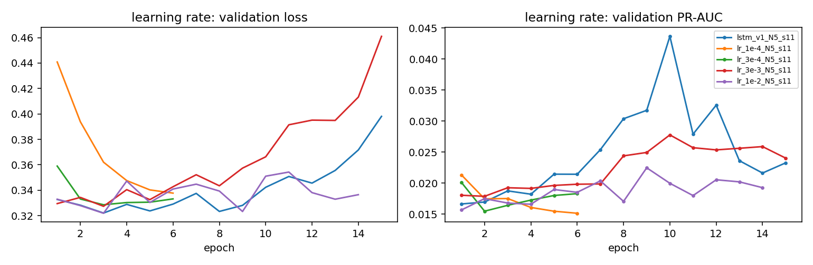
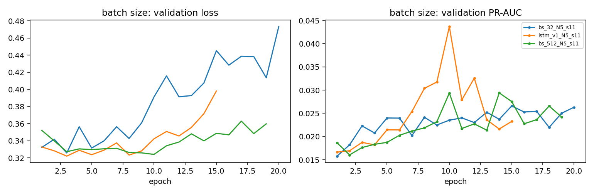
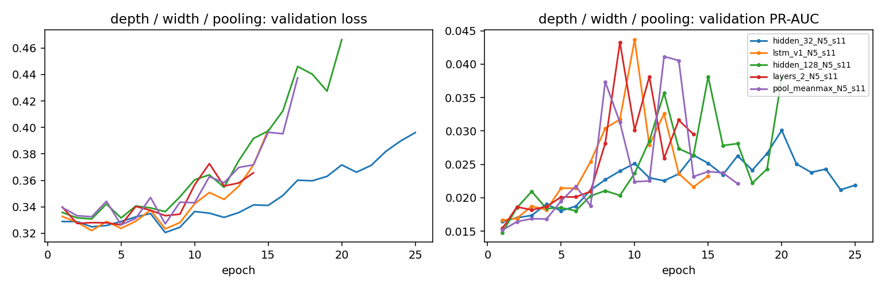
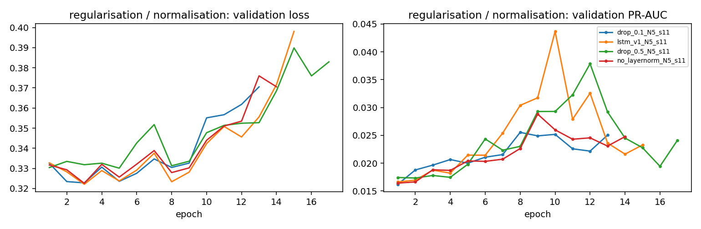
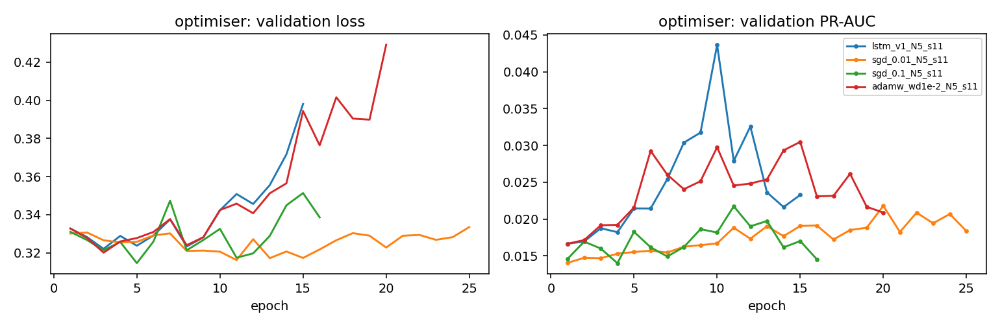
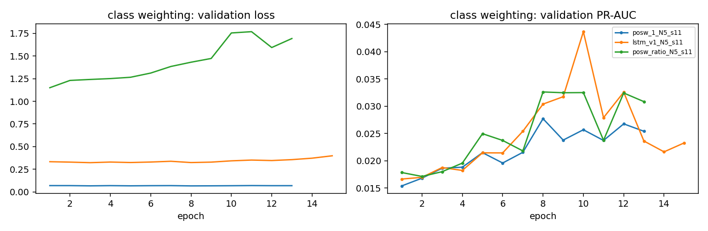
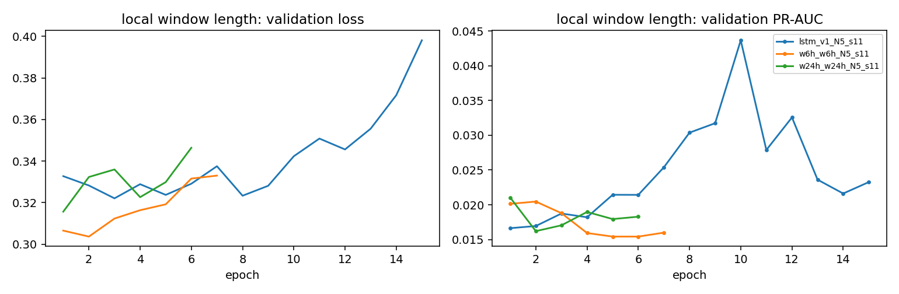
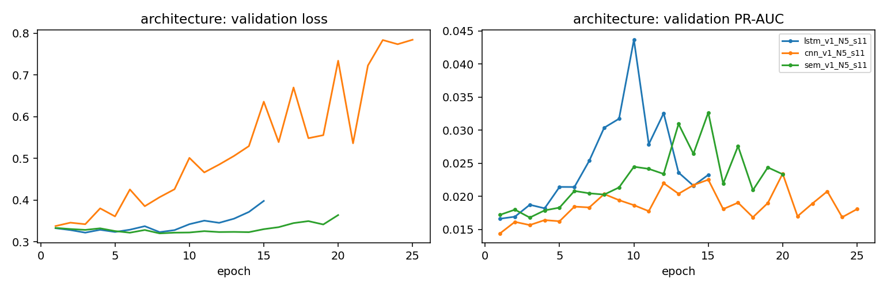
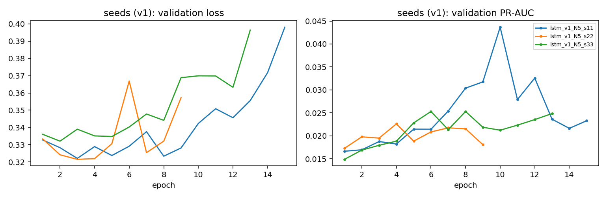

# Optimisation study (Question 3.b) — auto-generated by src/models/study_summary.py

All runs: N = 5 min, seed 11 unless stated, selected/evaluated on VALIDATION only. Reference = lstm_v1 (Adam 1e-3, batch 128, 1×64, dropout 0.3, LayerNorm, last-state pooling, pos_weight √ratio, 60-min local window).

## learning rate

| run            | changed         |   val PR-AUC |   ROC |   recall@1%FAR | best epoch / trained   |   min val loss |   train s | status   |
|:---------------|:----------------|-------------:|------:|---------------:|:-----------------------|---------------:|----------:|:---------|
| lstm_v1_N5_s11 |                 |       0.0437 | 0.668 |          0.036 | 10/15                  |         0.3221 |       nan | ok       |
| lr_1e-4_N5_s11 | lr 1e-3 -> 1e-4 |       0.0213 | 0.545 |          0.026 | 1/6                    |         0.3377 |       501 | ok       |
| lr_3e-4_N5_s11 | lr 1e-3 -> 3e-4 |       0.0201 | 0.557 |          0.026 | 1/6                    |         0.3286 |       524 | ok       |
| lr_3e-3_N5_s11 | lr 1e-3 -> 3e-3 |       0.0278 | 0.676 |          0.031 | 10/15                  |         0.3274 |      1334 | ok       |
| lr_1e-2_N5_s11 | lr 1e-3 -> 1e-2 |       0.0225 | 0.673 |          0.031 | 9/14                   |         0.3219 |      1214 | ok       |

## batch size

| run            | changed          |   val PR-AUC |   ROC |   recall@1%FAR | best epoch / trained   |   min val loss |   train s | status   |
|:---------------|:-----------------|-------------:|------:|---------------:|:-----------------------|---------------:|----------:|:---------|
| bs_32_N5_s11   | batch 128 -> 32  |       0.0266 | 0.647 |          0.062 | 15/20                  |         0.3258 |      2902 | ok       |
| lstm_v1_N5_s11 |                  |       0.0437 | 0.668 |          0.036 | 10/15                  |         0.3221 |       nan | ok       |
| bs_512_N5_s11  | batch 128 -> 512 |       0.0294 | 0.657 |          0.041 | 14/19                  |         0.3241 |      4446 | ok       |

## depth / width / pooling

| run                 | changed                        |   val PR-AUC |   ROC |   recall@1%FAR | best epoch / trained   |   min val loss |   train s | status   |
|:--------------------|:-------------------------------|-------------:|------:|---------------:|:-----------------------|---------------:|----------:|:---------|
| hidden_32_N5_s11    | hidden 64 -> 32                |       0.0301 | 0.661 |          0.062 | 20/25                  |         0.3205 |      1494 | ok       |
| lstm_v1_N5_s11      |                                |       0.0437 | 0.668 |          0.036 | 10/15                  |         0.3221 |       nan | ok       |
| hidden_128_N5_s11   | hidden 64 -> 128               |       0.0381 | 0.666 |          0.073 | 15/20                  |         0.3308 |      6045 | ok       |
| layers_2_N5_s11     | 1 -> 2 LSTM layers             |       0.0432 | 0.655 |          0.031 | 9/14                   |         0.3263 |      2439 | ok       |
| pool_meanmax_N5_s11 | last state -> mean+max pooling |       0.0411 | 0.649 |          0.026 | 12/17                  |         0.3264 |      2546 | ok       |

## regularisation / normalisation

| run                 | changed            |   val PR-AUC |   ROC |   recall@1%FAR | best epoch / trained   |   min val loss |   train s | status   |
|:--------------------|:-------------------|-------------:|------:|---------------:|:-----------------------|---------------:|----------:|:---------|
| drop_0.1_N5_s11     | dropout 0.3 -> 0.1 |       0.0255 | 0.678 |          0.041 | 8/13                   |         0.3228 |      1324 | ok       |
| lstm_v1_N5_s11      |                    |       0.0437 | 0.668 |          0.036 | 10/15                  |         0.3221 |       nan | ok       |
| drop_0.5_N5_s11     | dropout 0.3 -> 0.5 |       0.0379 | 0.642 |          0.073 | 12/17                  |         0.3301 |      1720 | ok       |
| no_layernorm_N5_s11 | LayerNorm removed  |       0.0288 | 0.677 |          0.057 | 9/14                   |         0.3226 |      1412 | ok       |

## optimiser

| run                 | changed                           |   val PR-AUC |   ROC |   recall@1%FAR | best epoch / trained   |   min val loss |   train s | status   |
|:--------------------|:----------------------------------|-------------:|------:|---------------:|:-----------------------|---------------:|----------:|:---------|
| lstm_v1_N5_s11      |                                   |       0.0437 | 0.668 |          0.036 | 10/15                  |         0.3221 |       nan | ok       |
| sgd_0.01_N5_s11     | Adam -> SGD momentum 0.9, lr 0.01 |       0.0218 | 0.645 |          0.026 | 20/25                  |         0.3162 |      2600 | ok       |
| sgd_0.1_N5_s11      | Adam -> SGD momentum 0.9, lr 0.1  |       0.0217 | 0.694 |          0     | 11/16                  |         0.3146 |      1526 | ok       |
| adamw_wd1e-2_N5_s11 | Adam -> AdamW, weight decay 1e-2  |       0.0305 | 0.663 |          0.031 | 15/20                  |         0.3201 |      2011 | ok       |

## class weighting

| run               | changed                             |   val PR-AUC |   ROC |   recall@1%FAR | best epoch / trained   |   min val loss |   train s | status   |
|:------------------|:------------------------------------|-------------:|------:|---------------:|:-----------------------|---------------:|----------:|:---------|
| posw_1_N5_s11     | pos_weight sqrt -> none (1)         |       0.0277 | 0.683 |          0.031 | 8/13                   |         0.0655 |      1321 | ok       |
| lstm_v1_N5_s11    |                                     |       0.0437 | 0.668 |          0.036 | 10/15                  |         0.3221 |       nan | ok       |
| posw_ratio_N5_s11 | pos_weight sqrt -> full ratio (~65) |       0.0326 | 0.671 |          0.041 | 8/13                   |         1.15   |      1324 | ok       |

## local window length

| run              | changed                     |   val PR-AUC |   ROC |   recall@1%FAR | best epoch / trained   |   min val loss |   train s | status   |
|:-----------------|:----------------------------|-------------:|------:|---------------:|:-----------------------|---------------:|----------:|:---------|
| lstm_v1_N5_s11   |                             |       0.0437 | 0.668 |          0.036 | 10/15                  |         0.3221 |       nan | ok       |
| w6h_w6h_N5_s11   | local window 60 min -> 6 h  |       0.0205 | 0.647 |          0.042 | 2/7                    |         0.3037 |       774 | ok       |
| w24h_w24h_N5_s11 | local window 60 min -> 24 h |       0.021  | 0.641 |          0.06  | 1/6                    |         0.3157 |       742 | ok       |

## architecture

| run            | changed                                                                       |   val PR-AUC |   ROC |   recall@1%FAR | best epoch / trained   |   min val loss |   train s | status   |
|:---------------|:------------------------------------------------------------------------------|-------------:|------:|---------------:|:-----------------------|---------------:|----------:|:---------|
| lstm_v1_N5_s11 |                                                                               |       0.0437 | 0.668 |          0.036 | 10/15                  |         0.3221 |       nan | ok       |
| cnn_v1_N5_s11  | LSTM -> 1-D CNN (kernels 3/5/7 x 64), masked max-pool                         |       0.0234 | 0.601 |          0.036 | 20/25                  |         0.3378 |      1758 | ok       |
| sem_v1_N5_s11  | learned template embedding -> frozen MiniLM text embeddings projected to 64-d |       0.0327 | 0.677 |          0.026 | 15/20                  |         0.3203 |      2536 | ok       |

## seeds (v1)

| run            | changed   |   val PR-AUC |   ROC |   recall@1%FAR | best epoch / trained   |   min val loss | train s   | status   |
|:---------------|:----------|-------------:|------:|---------------:|:-----------------------|---------------:|:----------|:---------|
| lstm_v1_N5_s11 |           |       0.0437 | 0.668 |          0.036 | 10/15                  |         0.3221 |           | ok       |
| lstm_v1_N5_s22 |           |       0.0226 | 0.648 |          0.031 | 4/9                    |         0.3215 |           | ok       |
| lstm_v1_N5_s33 |           |       0.0253 | 0.64  |          0.031 | 8/13                   |         0.332  |           | ok       |

## Notes

The interpretation of every study (effect size vs the ±0.012 seed spread, mechanism, optimiser behaviour, unsuccessful runs) is written in `docs/phase5_findings.md`; per-run statements are in `experiments/log.csv` (column `learned`).
