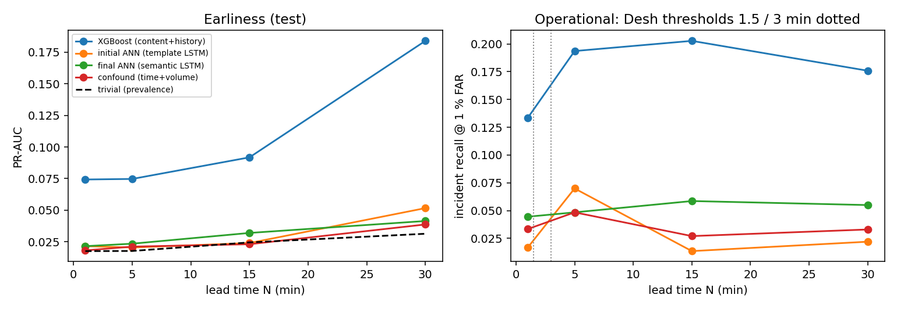

# FINAL TEST EVALUATION (run once) — all models, all conditions

## Protocol

```
{
 "split": "test",
 "split_file": "data/splits/split_v1.json",
 "templates": "Drain3 fitted on train only (317 templates; UNK=1)",
 "windows": "unit=midplane, W_local=W_global=60 min, H=10 min, offsets 0..8",
 "negatives": "uniform (unit, minute) within split period; hard negatives 30 s after non-target alerts",
 "far_levels": [
  0.001,
  0.01
 ],
 "seeds": [
  11,
  22,
  33
 ],
 "thresholds_frozen_from": "validation"
}
```

## Comparison table (primary metric PR-AUC; mean ± sd over seeds where available)

| model                 |   N | PR-AUC          |   ROC-AUC |   recall@0.1%FAR |   recall@1%FAR |   incident recall@1% | train s   |   infer ms/window |   seeds |
|:----------------------|----:|:----------------|----------:|-----------------:|---------------:|---------------------:|:----------|------------------:|--------:|
| trivial               |   1 | 0.0176          |     0.5   |            0     |          0     |                0     |           |             0     |       1 |
| trivial               |   5 | 0.0177          |     0.5   |            0     |          0     |                0     |           |             0     |       1 |
| trivial               |  15 | 0.0245          |     0.5   |            0     |          0     |                0     |           |             0     |       1 |
| trivial               |  30 | 0.0313          |     0.5   |            0     |          0     |                0     |           |             0     |       1 |
| confound_lr           |   1 | 0.0181          |     0.527 |            0.004 |          0.007 |                0.033 | 0         |             0.004 |       1 |
| confound_lr           |   5 | 0.0211          |     0.551 |            0     |          0.017 |                0.048 | 0         |             0.001 |       1 |
| confound_lr           |  15 | 0.0231          |     0.504 |            0     |          0.014 |                0.027 | 0         |             0.001 |       1 |
| confound_lr           |  30 | 0.0387          |     0.608 |            0.002 |          0.018 |                0.033 | 0         |             0.001 |       1 |
| xgboost_history_only  |   1 | 0.0580          |     0.736 |            0.025 |          0.124 |                0.15  | 0         |             0.002 |       1 |
| xgboost_history_only  |   5 | 0.0477          |     0.675 |            0.003 |          0.126 |                0.145 | 1         |             0.002 |       1 |
| xgboost_history_only  |  15 | 0.0820          |     0.685 |            0.041 |          0.11  |                0.189 | 0         |             0.002 |       1 |
| xgboost_history_only  |  30 | 0.1328          |     0.739 |            0.034 |          0.175 |                0.187 | 0         |             0.003 |       1 |
| xgboost_content       |   1 | 0.0325          |     0.698 |            0     |          0     |                0     | 8         |             0.006 |       1 |
| xgboost_content       |   5 | 0.0444          |     0.731 |            0.007 |          0.014 |                0.032 | 17        |             0.008 |       1 |
| xgboost_content       |  15 | 0.0327          |     0.638 |            0.003 |          0.008 |                0.027 | 8         |             0.012 |       1 |
| xgboost_content       |  30 | 0.0503          |     0.676 |            0     |          0.005 |                0.011 | 12        |             0.013 |       1 |
| xgboost               |   1 | 0.0743          |     0.805 |            0     |          0.142 |                0.133 | 8         |             0.006 |       1 |
| xgboost               |   5 | 0.0747          |     0.792 |            0.017 |          0.192 |                0.194 | 27        |             0.008 |       1 |
| xgboost               |  15 | 0.0918          |     0.751 |            0.044 |          0.16  |                0.203 | 10        |             0.01  |       1 |
| xgboost               |  30 | 0.1840          |     0.755 |            0.059 |          0.205 |                0.176 | 22        |             0.009 |       1 |
| lstm_v1 (initial ANN) |   1 | 0.0215          |     0.615 |            0     |          0.004 |                0.017 | 1353      |             0.208 |       1 |
| lstm_v1 (initial ANN) |   5 | 0.0204 ± 0.0027 |     0.528 |            0.001 |          0.042 |                0.07  |           |             0.198 |       3 |
| lstm_v1 (initial ANN) |  15 | 0.0240          |     0.529 |            0.003 |          0.003 |                0.014 | 716       |             0.219 |       1 |
| lstm_v1 (initial ANN) |  30 | 0.0516          |     0.647 |            0.005 |          0.011 |                0.022 | 1342      |             0.214 |       1 |
| sem_final (final ANN) |   1 | 0.0215 ± 0.0007 |     0.599 |            0.002 |          0.016 |                0.044 | 1430      |             0.35  |       3 |
| sem_final (final ANN) |   5 | 0.0235 ± 0.0019 |     0.595 |            0     |          0.017 |                0.048 | 2663      |             0.381 |       3 |
| sem_final (final ANN) |  15 | 0.0320 ± 0.0064 |     0.562 |            0.019 |          0.029 |                0.059 | 1381      |             0.382 |       3 |
| sem_final (final ANN) |  30 | 0.0414 ± 0.0043 |     0.626 |            0.022 |          0.025 |                0.055 | 1661      |             0.393 |       3 |



## Final ANN: per-category incident recall and hard-negative false-alarm rate (1 % FAR threshold)

Cells: incident recall at the 1 % FAR threshold (number of incidents in this split).

| category   | 1         | 5         | 15        | 30        |
|:-----------|:----------|:----------|:----------|:----------|
| KERNCON    | 0.00 (1)  | 0.00 (1)  | 1.00 (1)  | 1.00 (1)  |
| KERNDTLB   | 0.00 (1)  | 0.00 (2)  | 0.00 (2)  | 0.00 (2)  |
| KERNFLOAT  | 0.00 (1)  | 0.00 (1)  | 0.00 (1)  | 0.00 (1)  |
| KERNMC     | 0.06 (36) | 0.08 (38) | 0.02 (45) | 0.04 (54) |
| KERNNOETH  | 0.00 (1)  | 0.00 (1)  | —         | 0.00 (1)  |
| KERNPAN    | —         | —         | —         | 0.00 (1)  |
| KERNREC    | 0.00 (1)  | —         | —         | 0.00 (1)  |
| KERNRTSA   | 0.00 (1)  | 0.00 (1)  | 0.00 (1)  | 0.00 (1)  |
| KERNRTSP   | 0.00 (1)  | 0.00 (1)  | 0.00 (1)  | 0.00 (1)  |
| KERNSERV   | 0.00 (4)  | 0.00 (3)  | 0.00 (3)  | 0.00 (3)  |
| KERNSOCK   | 0.00 (13) | 0.00 (13) | 0.00 (18) | 0.05 (21) |
| KERNSTOR   | —         | 0.00 (1)  | 1.00 (1)  | 0.50 (2)  |
| KERNTLBE   | —         | —         | 0.00 (1)  | 0.00 (1)  |

Hard negatives (alert-rich windows not followed by a failure) vs ordinary negatives:

|   N |   ordinary negatives |   FAR ordinary |   hard negatives |   FAR hard |
|----:|---------------------:|---------------:|-----------------:|-----------:|
|   1 |                14896 |         0.0097 |             2258 |     0      |
|   5 |                14771 |         0.0068 |             2257 |     0      |
|  15 |                14417 |         0.0089 |             2249 |     0.0031 |
|  30 |                13988 |         0.0217 |             2239 |     0.0045 |

## Generalisation to UNSEEN failure types (leave-one-category-out, N=5, seed 11)

| held-out category   |   incidents |   incident recall@1% — model NEVER saw this category |   incident recall@1% — all-category model |   PR-AUC (category positives vs all negatives) — held-out model |   PR-AUC — all-category model |   ROC — held-out model |
|:--------------------|------------:|-----------------------------------------------------:|------------------------------------------:|----------------------------------------------------------------:|------------------------------:|-----------------------:|
| KERNMC              |          38 |                                                0.079 |                                     0.079 |                                                          0.0118 |                        0.0192 |                  0.612 |
| KERNRTSP            |           1 |                                                0     |                                     0     |                                                          0.0001 |                        0.0001 |                  0.046 |
| KERNSOCK            |          13 |                                                0.077 |                                     0     |                                                          0.0122 |                        0.0063 |                  0.568 |
| KERNDTLB            |           2 |                                                0     |                                     0.5   |                                                          0.0017 |                        0.0036 |                  0.769 |

## Generalisation to UNSEEN machines (racks held out of training: ['NULL', 'R05', 'R07', 'R30', 'R32', 'R34', 'R40', 'R42', 'R51', 'R53', 'R65', 'R73', 'UNKNOWN_LOCATION']; N=5, seed 11)

| model                              | windows from                                             |   windows |   positives |   PR-AUC |   ROC-AUC |   incident recall@1% |
|:-----------------------------------|:---------------------------------------------------------|----------:|------------:|---------:|----------:|---------------------:|
| rack-held-out model                | held-out racks (never in training of the held-out model) |      3109 |          24 |   0.0134 |     0.706 |                0     |
| rack-held-out model                | seen racks                                               |     14205 |         262 |   0.028  |     0.564 |                0.107 |
| all-rack model (sem_final seed 11) | held-out racks (never in training of the held-out model) |      3109 |          24 |   0.0138 |     0.678 |                0     |
| all-rack model (sem_final seed 11) | seen racks                                               |     14205 |         262 |   0.0263 |     0.597 |                0.071 |

## Protocol controls (comparison only — never used for any model decision)

Transductive-template control scored on the test split (same windows, features rebuilt from templates that have seen all data):

|   N |   XGBoost, honest templates (train-only Drain): PR-AUC |   ROC |   XGBoost, transductive templates (Drain on all data): PR-AUC |   ROC  |   UNK rate of this split under honest templates |
|----:|-------------------------------------------------------:|------:|--------------------------------------------------------------:|-------:|------------------------------------------------:|
|   1 |                                                 0.0743 | 0.805 |                                                        0.0737 |  0.805 |                                           0.659 |
|   5 |                                                 0.0747 | 0.792 |                                                        0.0601 |  0.773 |                                           0.659 |
|  15 |                                                 0.0918 | 0.751 |                                                        0.0971 |  0.734 |                                           0.66  |
|  30 |                                                 0.184  | 0.755 |                                                        0.096  |  0.656 |                                           0.66  |

XGBoost best validation PR-AUC under each protocol (read from the Phase 3/6 result files):

| protocol                                                         |      1 |      5 |     15 |     30 |
|:-----------------------------------------------------------------|-------:|-------:|-------:|-------:|
| CONTROL: random window split (leaky protocol of most prior work) | 0.5814 | 0.5824 | 0.5813 | 0.6456 |
| CONTROL: transductive templates (Drain fitted on all data)       | 0.0266 | 0.0231 | 0.0226 | 0.0249 |
| honest: chronological split, templates fitted on train only      | 0.0266 | 0.0238 | 0.0226 | 0.0213 |
