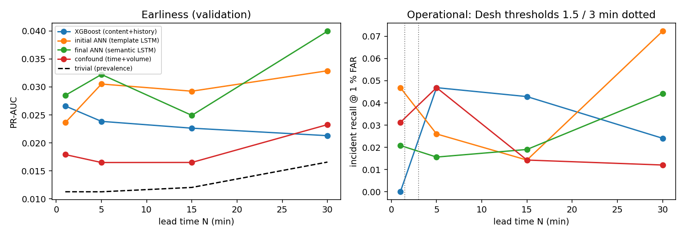

# Validation evaluation — all models, all conditions

## Protocol

```
{
 "split": "validation",
 "split_file": "data/splits/split_v1.json",
 "templates": "Drain3 fitted on train only (317 templates; UNK=1)",
 "windows": "unit=midplane, W_local=W_global=60 min, H=10 min, offsets 0..8",
 "negatives": "uniform (unit, minute) within split period; hard negatives 30 s after non-target alerts",
 "far_levels": [
  0.001,
  0.01
 ],
 "seeds": [
  11,
  22,
  33
 ],
 "thresholds_frozen_from": "validation"
}
```

## Comparison table (primary metric PR-AUC; mean ± sd over seeds where available)

| model                 |   N | PR-AUC          |   ROC-AUC |   recall@0.1%FAR |   recall@1%FAR |   incident recall@1% | train s   |   infer ms/window |   seeds |
|:----------------------|----:|:----------------|----------:|-----------------:|---------------:|---------------------:|:----------|------------------:|--------:|
| trivial               |   1 | 0.0113          |     0.5   |            0     |          0     |                0     |           |             0     |       1 |
| trivial               |   5 | 0.0113          |     0.5   |            0     |          0     |                0     |           |             0     |       1 |
| trivial               |  15 | 0.0120          |     0.5   |            0     |          0     |                0     |           |             0     |       1 |
| trivial               |  30 | 0.0166          |     0.5   |            0     |          0     |                0     |           |             0     |       1 |
| confound_lr           |   1 | 0.0179          |     0.56  |            0.005 |          0.025 |                0.031 | 0         |             0.001 |       1 |
| confound_lr           |   5 | 0.0165          |     0.536 |            0     |          0.031 |                0.047 | 0         |             0.001 |       1 |
| confound_lr           |  15 | 0.0165          |     0.544 |            0     |          0.02  |                0.014 | 0         |             0.001 |       1 |
| confound_lr           |  30 | 0.0233          |     0.526 |            0.019 |          0.019 |                0.012 | 0         |             0.001 |       1 |
| xgboost_history_only  |   1 | 0.0125          |     0.428 |            0     |          0.02  |                0.031 | 0         |             0.002 |       1 |
| xgboost_history_only  |   5 | 0.0118          |     0.464 |            0     |          0.01  |                0.031 | 1         |             0.003 |       1 |
| xgboost_history_only  |  15 | 0.0132          |     0.506 |            0     |          0.015 |                0.029 | 0         |             0.003 |       1 |
| xgboost_history_only  |  30 | 0.0202          |     0.522 |            0     |          0.012 |                0.024 | 0         |             0.003 |       1 |
| xgboost_content       |   1 | 0.0198          |     0.661 |            0     |          0     |                0     | 8         |             0.006 |       1 |
| xgboost_content       |   5 | 0.0208          |     0.67  |            0     |          0.016 |                0.016 | 17        |             0.009 |       1 |
| xgboost_content       |  15 | 0.0219          |     0.644 |            0     |          0.031 |                0.029 | 8         |             0.011 |       1 |
| xgboost_content       |  30 | 0.0230          |     0.584 |            0     |          0.015 |                0.012 | 12        |             0.011 |       1 |
| xgboost               |   1 | 0.0266          |     0.697 |            0     |          0     |                0     | 8         |             0.008 |       1 |
| xgboost               |   5 | 0.0238          |     0.658 |            0     |          0.036 |                0.047 | 27        |             0.01  |       1 |
| xgboost               |  15 | 0.0226          |     0.647 |            0.005 |          0.051 |                0.043 | 10        |             0.009 |       1 |
| xgboost               |  30 | 0.0213          |     0.59  |            0     |          0.012 |                0.024 | 22        |             0.009 |       1 |
| lstm_v1 (initial ANN) |   1 | 0.0236          |     0.685 |            0     |          0.035 |                0.047 | 1353      |             0.207 |       1 |
| lstm_v1 (initial ANN) |   5 | 0.0305 ± 0.0115 |     0.652 |            0.026 |          0.033 |                0.026 |           |             0.191 |       3 |
| lstm_v1 (initial ANN) |  15 | 0.0292          |     0.585 |            0.041 |          0.041 |                0.014 | 716       |             0.21  |       1 |
| lstm_v1 (initial ANN) |  30 | 0.0329          |     0.616 |            0.004 |          0.058 |                0.072 | 1342      |             0.244 |       1 |
| sem_final (final ANN) |   1 | 0.0285 ± 0.0021 |     0.669 |            0.015 |          0.032 |                0.021 | 1430      |             0.336 |       3 |
| sem_final (final ANN) |   5 | 0.0322 ± 0.0004 |     0.678 |            0.01  |          0.028 |                0.016 | 2663      |             0.359 |       3 |
| sem_final (final ANN) |  15 | 0.0249 ± 0.0103 |     0.616 |            0.009 |          0.024 |                0.019 | 1381      |             0.376 |       3 |
| sem_final (final ANN) |  30 | 0.0400 ± 0.0056 |     0.581 |            0.023 |          0.065 |                0.044 | 1661      |             0.403 |       3 |



## Final ANN: per-category incident recall and hard-negative false-alarm rate (1 % FAR threshold)

Cells: incident recall at the 1 % FAR threshold (number of incidents in this split).

| category   | 1         | 5         | 15        | 30        |
|:-----------|:----------|:----------|:----------|:----------|
| KERNBIT    | 0.00 (1)  | 0.00 (1)  | 0.00 (1)  | 0.00 (1)  |
| KERNCON    | 0.00 (2)  | 0.00 (2)  | 0.00 (4)  | 0.00 (4)  |
| KERNFLOAT  | 0.00 (1)  | 0.00 (1)  | 0.00 (1)  | 0.00 (1)  |
| KERNMC     | 0.00 (42) | 0.00 (43) | 0.00 (51) | 0.05 (59) |
| KERNMICRO  | 0.00 (2)  | 0.00 (2)  | 0.00 (2)  | 0.00 (2)  |
| KERNNOETH  | 0.00 (3)  | 0.00 (3)  | 0.00 (2)  | 0.00 (2)  |
| KERNPAN    | 0.00 (5)  | 0.00 (5)  | 0.00 (5)  | 0.00 (5)  |
| KERNPOW    | 0.00 (1)  | 0.00 (1)  | 0.00 (1)  | 0.00 (2)  |
| KERNPROG   | 0.00 (1)  | 0.00 (1)  | 0.00 (1)  | 0.00 (1)  |
| KERNRTSP   | 1.00 (1)  | 1.00 (1)  | 1.00 (1)  | 0.50 (2)  |
| KERNSOCK   | 0.00 (2)  | 0.00 (2)  | 0.00 (1)  | 0.00 (2)  |
| KERNTERM   | 0.00 (2)  | 0.00 (1)  | —         | 0.00 (1)  |

Hard negatives (alert-rich windows not followed by a failure) vs ordinary negatives:

|   N |   ordinary negatives |   FAR ordinary |   hard negatives |   FAR hard |
|----:|---------------------:|---------------:|-----------------:|-----------:|
|   1 |                14171 |         0.0095 |             1504 |     0.0007 |
|   5 |                14095 |         0.0064 |             1504 |     0      |
|  15 |                13899 |         0.0024 |             1504 |     0      |
|  30 |                13638 |         0.0089 |             1504 |     0      |

## Generalisation to UNSEEN failure types (leave-one-category-out, N=5, seed 11)

| held-out category   |   incidents |   incident recall@1% — model NEVER saw this category |   incident recall@1% — all-category model |   PR-AUC (category positives vs all negatives) — held-out model |   PR-AUC — all-category model |   ROC — held-out model |
|:--------------------|------------:|-----------------------------------------------------:|------------------------------------------:|----------------------------------------------------------------:|------------------------------:|-----------------------:|
| KERNMC              |          43 |                                                    0 |                                         0 |                                                          0.0123 |                        0.0137 |                  0.639 |
| KERNRTSP            |           1 |                                                    0 |                                         1 |                                                          0.0072 |                        0.2492 |                  0.866 |
| KERNSOCK            |           2 |                                                    0 |                                         0 |                                                          0.0003 |                        0.0003 |                  0.679 |
| KERNDTLB            |           0 |                                                  nan |                                       nan |                                                        nan      |                      nan      |                nan     |

## Generalisation to UNSEEN machines (racks held out of training: ['NULL', 'R05', 'R07', 'R30', 'R32', 'R34', 'R40', 'R42', 'R51', 'R53', 'R65', 'R73', 'UNKNOWN_LOCATION']; N=5, seed 11)

| model                              | windows from                                             |   windows |   positives |   PR-AUC |   ROC-AUC |   incident recall@1% |
|:-----------------------------------|:---------------------------------------------------------|----------:|------------:|---------:|----------:|---------------------:|
| rack-held-out model                | held-out racks (never in training of the held-out model) |      2786 |          26 |   0.0669 |     0.649 |                0.091 |
| rack-held-out model                | seen racks                                               |     13006 |         167 |   0.043  |     0.687 |                0.037 |
| all-rack model (sem_final seed 11) | held-out racks (never in training of the held-out model) |      2786 |          26 |   0.024  |     0.671 |                0.091 |
| all-rack model (sem_final seed 11) | seen racks                                               |     13006 |         167 |   0.0349 |     0.677 |                0.019 |

## Protocol controls (comparison only — never used for any model decision)

Transductive-template control scored on the validation split (same windows, features rebuilt from templates that have seen all data):

|   N |   XGBoost, honest templates (train-only Drain): PR-AUC |   ROC |   XGBoost, transductive templates (Drain on all data): PR-AUC |   ROC  |   UNK rate of this split under honest templates |
|----:|-------------------------------------------------------:|------:|--------------------------------------------------------------:|-------:|------------------------------------------------:|
|   1 |                                                 0.0266 | 0.697 |                                                        0.0266 |  0.697 |                                           0.028 |
|   5 |                                                 0.0238 | 0.658 |                                                        0.0231 |  0.653 |                                           0.028 |
|  15 |                                                 0.0226 | 0.647 |                                                        0.0226 |  0.645 |                                           0.028 |
|  30 |                                                 0.0213 | 0.59  |                                                        0.0249 |  0.528 |                                           0.028 |

XGBoost best validation PR-AUC under each protocol (read from the Phase 3/6 result files):

| protocol                                                         |      1 |      5 |     15 |     30 |
|:-----------------------------------------------------------------|-------:|-------:|-------:|-------:|
| CONTROL: random window split (leaky protocol of most prior work) | 0.5814 | 0.5824 | 0.5813 | 0.6456 |
| CONTROL: transductive templates (Drain fitted on all data)       | 0.0266 | 0.0231 | 0.0226 | 0.0249 |
| honest: chronological split, templates fitted on train only      | 0.0266 | 0.0238 | 0.0226 | 0.0213 |
